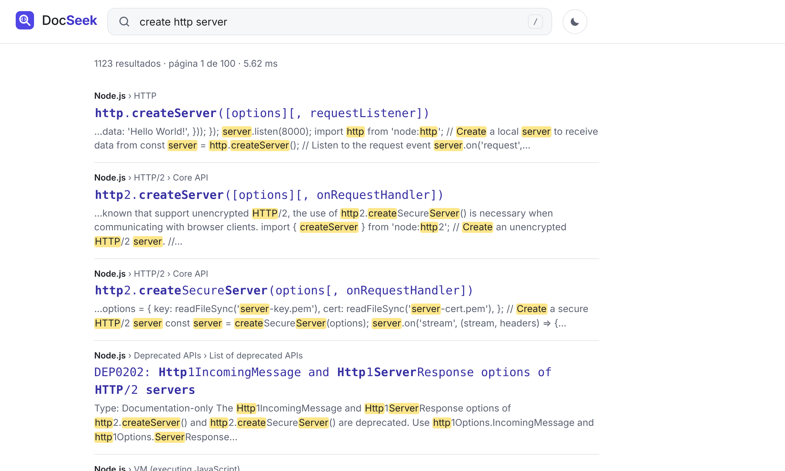
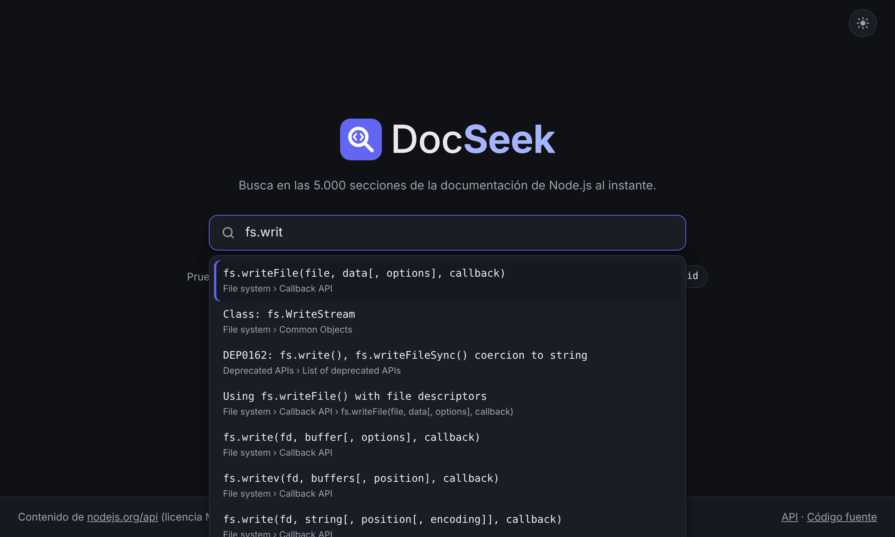
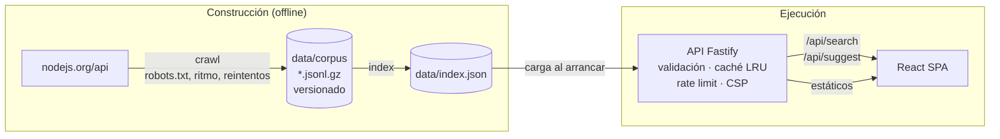

# DocSeek

Buscador de documentación técnica escrito en TypeScript: **rastreador**, **motor de búsqueda propio** (índice invertido + BM25F), **API** y **frontend**. Busca entre las 5.000 secciones de la documentación de la API de Node.js, con autocompletado, tolerancia a erratas y enlaces directos a cada sección. Cada búsqueda tarda unos 2 ms.

[](https://github.com/devcast42/00001-google-homepage-clone/actions/workflows/ci.yml)



## En números

|                      |                                                                                  |
| -------------------- | -------------------------------------------------------------------------------- |
| Corpus               | 5.013 secciones de 68 páginas de [nodejs.org/api](https://nodejs.org/api/)       |
| Índice               | 18.045 términos · 6,5 MB · se carga en ~65 ms · ~33 MB de memoria                |
| Latencia del motor   | búsqueda p50 **2,1 ms** · p95 **4,6 ms** · autocompletado p95 5,3 ms             |
| Calidad (validación) | acierto en el 1.º resultado **60 %** · en los 3 primeros **80 %** · MRR **0,70** |
| Pruebas              | 119 unitarias/integración · 22 e2e en escritorio y móvil · WCAG 2.1 AA con axe   |
| Cobertura            | 96 % de líneas · 88 % de ramas                                                   |

Las cifras se reproducen con `npm run bench:latency` y `npm run bench:relevance`. La metodología está en [ADR 0004](docs/adr/0004-ranking.md).

## Qué hace

- **Entiende código**: "readFile", "read file" y "fs.readFile" encuentran `fs.readFile()`; "base name" encuentra `path.basename()`.
- **Corrige erratas**: "readFiel" → `fs.readFile()`, con "¿Quisiste decir _readFile_?"; "chld proces" → "¿Quisiste decir _child process_?".
- **Autocompletado accesible** mientras escribes (patrón _combobox_ de WAI-ARIA, todo con teclado, `/` para enfocar).
- **Lleva a la sección exacta** (`nodejs.org/api/fs.html#fsreadfilepath-options-callback`), con la ruta de encabezados y un fragmento con las coincidencias resaltadas.
- **URLs compartibles** (`/?q=readFile&page=2`); los botones atrás y adelante funcionan.
- Modo claro y oscuro, diseño adaptado a móvil, sin desbordes, respeta `prefers-reduced-motion`.



## Arquitectura



| Paquete                                  | Qué contiene                                                                                                                                                                        |
| ---------------------------------------- | ----------------------------------------------------------------------------------------------------------------------------------------------------------------------------------- |
| [`packages/engine`](packages/engine/src) | Motor sin dependencias: tokenizador para código, índice invertido con publicaciones delta-codificadas, BM25F, corrección con Levenshtein acotado, prefijos y fragmentos resaltados. |
| [`apps/crawler`](apps/crawler/src)       | Rastreador: robots.txt (RFC 9309), límite de ritmo por host, reintentos con backoff y `Retry-After`, deduplicación y extracción por secciones.                                      |
| [`apps/api`](apps/api/src)               | API Fastify: esquemas JSON, paginación, caché LRU con TTL, rate limit, `Server-Timing`, cabeceras de seguridad y CSP, health checks y apagado ordenado.                             |
| [`apps/web`](apps/web/src)               | React 19 + Vite: autocompletado accesible, estado en la URL, peticiones cancelables, tipos compartidos con el motor.                                                                |
| [`bench`](bench)                         | Evaluación de calidad (Success@k, MRR), ajuste de parámetros y latencia.                                                                                                            |
| [`e2e`](e2e)                             | Playwright en escritorio y móvil, y auditoría de accesibilidad con axe.                                                                                                             |

### Decisiones técnicas

- [ADR 0001 — Arquitectura y por qué un motor propio](docs/adr/0001-arquitectura.md)
- [ADR 0002 — Tokenización para código](docs/adr/0002-tokenizacion.md)
- [ADR 0003 — Rastreador respetuoso](docs/adr/0003-rastreador.md)
- [ADR 0004 — Ranking guiado por métricas](docs/adr/0004-ranking.md)

## Puesta en marcha

Requisitos: Node.js 22.12 o superior.

```bash
npm ci
npm run dev        # genera el índice y arranca la API (:3000) y Vite (:5173)
```

Abre http://localhost:5173.

Para producción:

```bash
npm run build && npm run index
npm start          # http://localhost:3000 (API + frontend)
```

Con Docker:

```bash
docker build -t docseek .
docker run -p 3000:3000 docseek
```

Para volver a rastrear la documentación (unos 35 s, con medio segundo entre peticiones):

```bash
npm run crawl && npm run index
```

### Configuración

| Variable                | Por defecto       |                                                                         |
| ----------------------- | ----------------- | ----------------------------------------------------------------------- |
| `PORT`                  | `3000`            |                                                                         |
| `HOST`                  | `0.0.0.0`         |                                                                         |
| `INDEX_PATH`            | `data/index.json` |                                                                         |
| `WEB_ROOT`              | `apps/web/dist`   | Si no existe, solo se sirve la API                                      |
| `RATE_LIMIT_PER_MINUTE` | `300`             | Por IP                                                                  |
| `CACHE_ENTRIES`         | `1000`            | Caché LRU de búsquedas (TTL 5 min)                                      |
| `TRUST_PROXY`           | `false`           | Ponlo a `true` detrás de un proxy para que el rate limit vea la IP real |
| `LOG_LEVEL`             | `info`            | Logs JSON (pino) con id de petición                                     |

Los valores inválidos detienen el arranque con un mensaje claro.

## API

```http
GET /api/search?q=readFile&page=1&pageSize=10&source=nodejs
```

```jsonc
{
  "query": "readFile",
  "page": 1,
  "pageSize": 10,
  "total": 1101,
  "totalPages": 111,
  "tookMs": 2.4,
  // "didYouMean": "readFile"  ← solo si se corrigió alguna palabra (p. ej. q=readFiel)
  "results": [
    {
      "url": "https://nodejs.org/api/fs.html#fsreadfilepath-options-callback",
      "breadcrumbs": ["File system", "Callback API"],
      "title": { "text": "fs.readFile(path[, options], callback)", "highlights": [[3, 11]] },
      "snippet": { "text": "…Asynchronously reads the entire contents…", "highlights": [[16, 21]] },
    },
  ],
}
```

| Ruta                      |                                                                     |
| ------------------------- | ------------------------------------------------------------------- |
| `GET /api/search`         | `q` (1–200 caracteres), `page` (1–100), `pageSize` (1–50), `source` |
| `GET /api/suggest`        | `q`, `limit` (1–20). Sugerencias para autocompletar                 |
| `GET /api/stats`          | Documentos, términos, fuentes y fecha del índice                    |
| `GET /healthz`, `/readyz` | Liveness y readiness (sin rate limit)                               |

Los errores siempre tienen la forma `{ "error": { "code": "invalid_request" | "rate_limited" | "not_found" | "internal", "message": "…" } }`. Los resaltados se devuelven como rangos y no como HTML, así que el contenido indexado nunca puede inyectar marcado.

## Calidad

Las pruebas e2e necesitan el navegador de Playwright. La primera vez, descárgalo con `npx playwright install chromium`.

```bash
npm run lint             # ESLint (incluidas las reglas de hooks de React) + Prettier
npm run typecheck        # TypeScript estricto en código, pruebas y benchmarks
npm run test:coverage    # Vitest con umbrales de cobertura
npm run test:e2e         # Playwright + axe (compila y genera el índice antes)
npm run bench:relevance  # Success@1/3 y MRR; -- --set holdout para validación
npm run bench:latency    # p50/p95/p99 de búsqueda y autocompletado
npm run bench:tune       # ajuste de parámetros del ranking
```

[CI](.github/workflows/ci.yml) ejecuta todo lo anterior en cada pull request. Falla si la calidad del ranking baja del umbral, y además construye y prueba la imagen Docker.

## Limitaciones y siguientes pasos

- **Búsqueda léxica**: no resuelve sinónimos ni paráfrasis ("command line arguments" no encuentra `process.argv`). El siguiente paso natural es una búsqueda híbrida con embeddings para volver a ordenar los primeros resultados.
- **Una sola fuente**. La arquitectura admite más (ver [ADR 0003](docs/adr/0003-rastreador.md)); MDN sería la siguiente.
- **Índice en memoria de un proceso**: va sobrado para decenas de miles de secciones; para millones haría falta fragmentarlo.
- **Juicios de relevancia escritos a mano** (76 consultas): con consultas reales registradas (de forma anónima) la evaluación sería más representativa.
- **Reindexado completo**: no hay actualización incremental.

## Historia

El repositorio empezó como un clon en HTML/CSS de la portada de Google, mi primer ejercicio de maquetación. Está en el historial (`git log --reverse`) y se transformó en este proyecto.

## Licencia

Código bajo [MIT](LICENSE). El contenido indexado pertenece al proyecto Node.js y se distribuye bajo su propia licencia (MIT); los resultados enlazan siempre a la fuente original.
